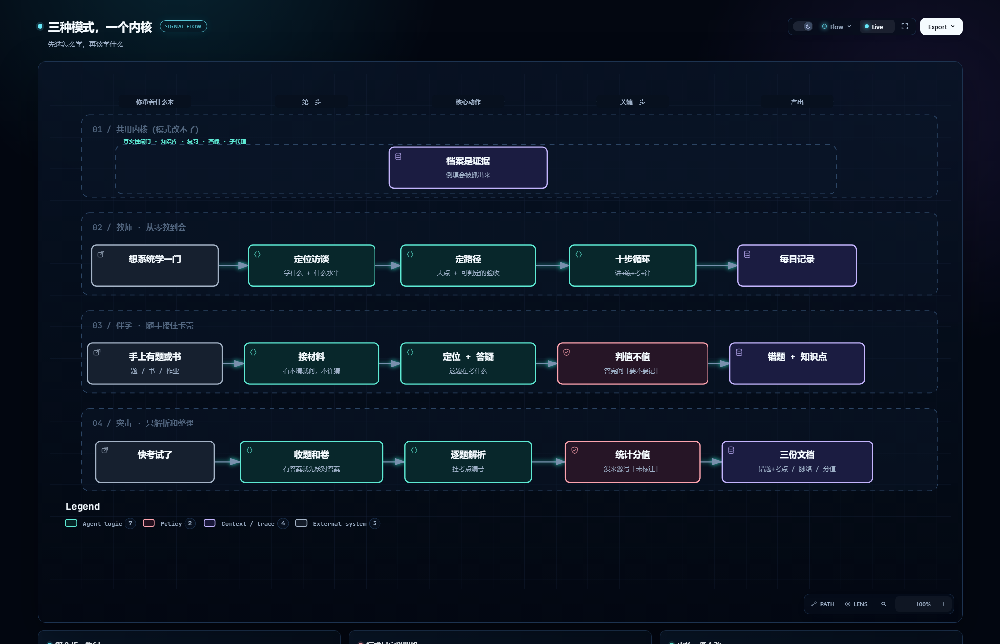

# ai-study

> **AI 可能骗你，档案不会。**
> 每条记录、每个分数、每次复习都带时间戳；倒填历史会被机器抓出来。

一个装进 agent 的**学习协议**，不是问答机器人。
它把「学」拆成可验证的循环，并用机器检查挡住 AI 最擅长的两件事：**编造进度、美化历史**。



---

## 它解决什么

AI 能回答任何问题，但**回答不等于学会**。
市面上的 AI 学习助手大多停在两件事：出题、讲解。聊完就忘，你所谓的「学会了」只是它的一句话。

带学要做的是把人从「看得懂」推到「做得出、答得对、记得住」——靠的是循环，不是单次问答。

## 三种带法，一个内核

进来第一件事是选模式。三个模式**共用同一套档案内核**，只有「一节课怎么走」不同。

| | **教师** | **伴学** | **突击** |
|---|---|---|---|
| 你带着什么来 | 「我想系统学一门」 | 一道题、一段书、一份作业 | 一堆卷子和答题卡 |
| 它做什么 | 定路径、按书讲、出题验收 | 答疑，并追问「要不要记」 | 只解析和整理，**不教书** |
| 产出 | 每日记录 + 板块笔记 | `05-错题.md` + 知识点 | 错题+考点 / 脉络 / 分值 |
| 一次多久 | 60–90 分钟 | 5–30 分钟 | 视卷子量 |

**教师**：先做苏格拉底式定位访谈，再依托经典教材与公开课反推大纲，
然后按「讲授 → 动手 → 征询 → 出题 → 讲评 → 归档」推进，每节课留一条记录。

**伴学**：你发什么它接什么。讲完一定问一句「这题要不要记下来」——
不记，这次卡壳就白卡了。记下的错题会提炼成知识点。

**突击**：题目进，三份文档出。错题挂考点、考点排分值，最后给你一张
「先补哪一块最划算」的矩阵。**它不教你**，这个边界是刻意的。

## 快速开始

```bash
git clone https://github.com/JiangShi-73/ai-study.git
cd ai-study
powershell -ExecutionPolicy Bypass -File install.ps1   # Windows
```

装到 `~/.agents/skills/ai-study`（不同 agent 目录不同，探测方法见 `ai-study/references/core/delegation.md`）。
安装会**跑一遍 11 项回归测试**，不过就拒绝安装，并把 `说明书/` 一起装进去。

装好后跟 agent 说一句就行：

> 「教我这个」　「陪我学」　「下周考试，帮我突击」

它会先问你选哪种模式，然后开始。

## 七条铁律

| # | 铁律 | 意思 |
|---|---|---|
| 0 | **不许编** | 每条记录、每个日期、每句「学生原话」都必须来自真实对话 |
| 1 | **先教后考** | 出题永远是最后一段，学生说「可以出题」才出 |
| 2 | **日历活着，但服从考核** | 日期到了考核没过 → 改日历，不跳步 |
| 3 | **讲授落到具体位置** | 书名 + 章 + 节 + 页，不是「了解一下」 |
| 4 | **没填就是没做** | 不编造学生没做过的进度，模板里不留「待填」 |
| 5 | **输出要能读** | 结论先行、一屏以内、标题分段、代码块可复制 |
| 6 | **主动权归学生** | 复习什么时候开始、哪几条、展示还是提问，全由他定 |

## 它怎么抓假

```bash
python ai-study/scripts/study.py lint <学习目录>
```

| 检查 | 依据 |
|---|---|
| **倒填历史** —— 声称某天上过课，但文件是今天建的 | 文件创建时间（改不了） |
| 预支复习、预支画像 | 同上 |
| 改了版本号却没写变更日志 | git 式版本规则 |
| 索引结果 ≠ 正文结果 | 对账 |
| 引用的图 / 知识库编号不存在 | 引用完整性 |
| 来源写了「错题 Q-003」，但错题本里没有 | 引用完整性 |

> 一次实测里，902 行虚构档案在旧版 lint 下**全绿通过**；补上文件创建时间检查后，同一批文件报 19 条错。
> 事故报告见 [示例/ai-study-验收报告-2026-10-22.md](示例/ai-study-验收报告-2026-10-22.md)。

### 自己验一下

不用信上面那张表，跑它：

```bash
python ai-study/scripts/study.py selftest
```

```
自检：造 4 条违法档案，看 lint 抓不抓得到

  ✓ 倒填历史（声称过去上过课） —— 抓到
  ✓ 预支复习（笔记未建就已在复习） —— 抓到
  ✓ 索引结果 ≠ 正文结果 —— 抓到
  ✓ 版本号超前于变更日志 —— 抓到

4/4 条被抓到，检查器可信。
```

**检查器自己也要被检查。** 上一版的占位符哨兵曾经「看起来装了，其实从没生效」——
直到有人故意埋了个雷，才发现 PowerShell 把它读成了乱码。

## 跨对话继承（设计原则）

**对话会死，档案不会。** 上下文爆了、换工具了、隔三个月回来——
只要把学习文件夹交给新的对话，就能接着学。

这个约束决定了文件夹里必须有什么：

| 文件 | 解决什么 |
|---|---|
| `从这里开始.md` | 任何 AI 打开文件夹就知道这是什么、先读哪三个 |
| `00-学习档案.md` | 契约（含模式）+ 看板：学到哪、上次错在哪 |
| `_进行中/对话尾巴.md` | 上次聊到哪、学生最后说的原话、下次第一句 |
| `_进行中/当前课.md` | 半节课断了，停在第几步 |

```bash
python ai-study/scripts/study.py resume <学习目录>   # 打印一张可粘贴的交接卡
```

**新对话不要问「上次讲到哪」——档案里有。**

## 档案长什么样

```
~/学习档案/〈学科〉/
  00-学习档案.md     契约 / 画像 / 状态看板 / 记录索引
  01-学习路径.md     大点 / 完成标准 / 日历
  02-每日笔记/       每节课一条，只追加
  03-板块笔记/       知识点（复习单位）
  04-知识库/         教材 / 课程 / 题库清单 + 用法
  05-错题.md         原始错题（伴学 / 突击）
  06-知识点脉络.md    考点依赖关系（突击）
  07-考点分值.md      优先级矩阵（突击）
```

**原始和提炼分开写。** 每日记录/错题本是「当时发生了什么」，板块笔记是「提炼后的结论」。
合并它们，你就再也分不清「我当时的理解」和「我后来才懂的」。

记录满 80 条会自动压缩：把最远的 40 条移进 `_归档/`，索引换成一行 + 一份自动统计的总结。
**移走不是删除**，原文件一字未改。

## 目录结构

给 agent 的规范，和给人看的说明书，**分开放**：

| 路径 | 给谁 | 是什么 |
|---|---|---|
| `ai-study/core/` | agent | 文件管理 / 接口 / 输出格式 / 画像 / 知识库 / 复习 / 提问 / 配图 / 子代理 |
| `ai-study/modes/` | agent | 教师 / 伴学 / 突击，每个只定义「谁主导 · 怎么走 · 产出什么 · 何时结束」 |
| `ai-study/templates/` | agent | 档案模板 |
| `ai-study/scripts/` | agent | `study.py`：建档案、体检、复习货架、压缩、迁移、自检 |
| **`说明书/`** | **人** | **8 份面向学生的说明，安装时随技能一起装** |
| `示例/_demo/` | 人 | 四份**虚构**演示档案（教师 / 伴学 / 突击 / 事故物证） |
| `图/` | 人 | 两张可交互动图：三种模式总览、教师十步循环 |
| `tools/` | 维护者 | 占位符检查、引用检查、回归测试、API 推送 |

## 文档

### 给学生看的（[说明书/](说明书/00-先读我.md)）

| 文件 | 看什么 |
|---|---|
| [00-先读我](说明书/00-先读我.md) | 这是什么、三种模式、文件在哪 |
| [01-三种模式怎么选](说明书/01-三种模式怎么选.md) | 按处境选，每个模式一节课长什么样 |
| [02-教师模式](说明书/02-教师模式.md) | 十步循环、为什么先教后考、进度怎么判断 |
| [03-伴学模式](说明书/03-伴学模式.md) | 五步答疑、错题本格式、批量试卷怎么处理 |
| [04-突击模式](说明书/04-突击模式.md) | 三种输入、三份产出、分值来源规则 |
| [05-笔记与档案](说明书/05-笔记与档案.md) | 五份档案、原始 vs 提炼、压缩 |
| [06-复习与遗忘](说明书/06-复习与遗忘.md) | 主动权、建议间隔、毕业规则 |
| [07-常见问题](说明书/07-常见问题.md) | 催不催、编不编、换学科、学不下去 |

### 直接看格式（不用装）

| 想看什么 | 打开 |
|---|---|
| 伴学的错题本 | [示例/_demo/伴学/05-错题.md](示例/_demo/伴学/05-错题.md) |
| 突击的知识点脉络 | [示例/_demo/突击/06-知识点脉络.md](示例/_demo/突击/06-知识点脉络.md) |
| 突击的优先级矩阵 | [示例/_demo/突击/07-考点分值.md](示例/_demo/突击/07-考点分值.md) |

四份演示都过了 `lint`，可以直接当模板抄。

### 交互动图（浏览器打开，可导出图片）

- [三种模式.html](图/三种模式.html) —— 三条路 + 一个内核
- [一节课怎么走.html](图/一节课怎么走.html) —— 教师模式的循环


## 它不做什么

| 不做 | 为什么 |
|---|---|
| 不保证提分 | 学会是你做题做出来的 |
| 不替你决定学什么 | 先访谈，再规划 |
| 不主动催复习 | 做多了就变成压力源，你开始躲它 |
| 不排死课表 | 日历可改，服从考核 |
| 不假装能看视频 | 先要截图，截不了才抽帧 |
| 不做 GUI | 目前是纯 Markdown + 一个脚本 |

## 现状与局限

- 三种模式都已实现，各有演示档案；**但还没有跑完一节真实的课**
- 只支持单机单学科多计划，没有云同步、没有多用户
- 内容正确性不做自动校验（那是设计上的取舍：能自动查的只有格式与真实性）
- Windows 上开发，install.ps1 只覆盖 Windows

## 许可

MIT
