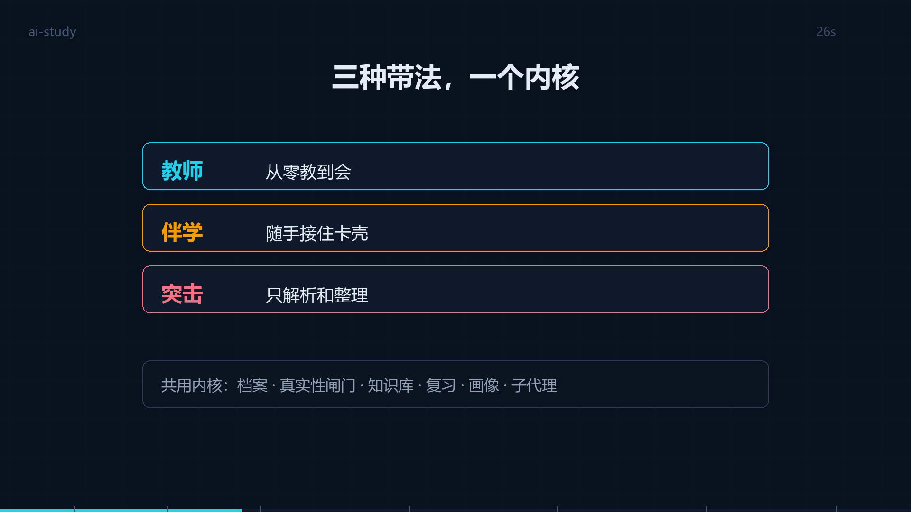

# ai-study · AI 带学系统

> **AI 可能骗你，档案不会。**
> 每条记录、每个分数、每次复习都带时间戳；倒填历史会被机器抓出来。

一个装进 agent 的**学习协议**，不是问答机器人。它把「学」拆成可验证的循环，
并且用机器检查挡住 AI 最擅长的两件事：编造进度、美化历史。

---

## 它解决什么

AI 能回答任何问题，但**回答不等于学会**。市面上的 AI 学习助手大多停在两件事：出题、讲解。

带学要做的是把人从「看得懂」推到「做得出、答得对、记得住」——靠的是循环，不是单次问答。

## 三十秒看懂

```
定位访谈 ──→ 路径规划 ──→ 每日循环 ──→ 五份档案 ──→ 滚动复习
苏格拉底式     大点+验收标准    讲→练→考→评→归档    00/01/02/03/04    展示式
```

## 三种带法，一个内核

进来第一件事是选模式。三个模式共用同一套档案内核，**只有"一节课怎么走"不同**。

| 模式 | 你带着什么来 | 它做什么 | 产出 |
|---|---|---|---|
| **教师** | 想系统学一门 | 定路径、讲课、出题、验收 | 每日记录 + 板块笔记 |
| **伴学** | 一道题、一段书、一份作业 | 答疑，并追问"要不要记" | `05-错题.md` + 知识点 |
| **突击** | 一堆题和卷子 | 只解析和整理，**不教书** | 三份：错题+考点 / 脉络 / 分值 |

左上角那张图就是这张表：[三种模式.html](视频/三种模式.html)

## 七条铁律

0. **不许编。** 每一条记录、每一个日期、每一句「学生原话」都必须来自真实对话。
1. **先教后考。** 出题永远是最后一段，学生说「可以出题」才出。
2. **日历活着，但服从考核。** 日期到了考核没过 → 改日历，不跳步。
3. **讲授要落到具体位置。** 书名 + 章 + 节 + 页，不是「了解一下」。
4. **主动权归学生。** 复习什么时候开始、复习哪几条、展示还是提问，全由他定。

## 它怎么抓假

```bash
python ai-study/scripts/study.py lint <学习目录>
```

| 检查 | 依据 |
|---|---|
| **倒填历史** —— 声称某天上过课，但文件是今天建的 | 文件创建时间（改不了） |
| 预支复习、预支画像 | 同上 |
| 改了版本号却没写变更日志 | git 式版本规则 |
| 索引结果 ≠ 正文结果 | 对账 |
| 引用的图 / 知识库编号不存在 | 引用完整性 |

> 一次实测里，902 行虚构档案在旧版 lint 下**全绿通过**；补上文件创建时间检查后，同一批文件报 19 条错。
> 事故报告见 `示例/ai-study-验收报告-2026-10-22.md`。

## 自己验一下

不用信上面那张表，跑它：

```bash
python ai-study/scripts/study.py selftest
```

```
自检：造 4 条违法档案，看 lint 抓不抓得到

  ✓ 倒填历史（声称过去上过课） —— 抓到
  ✓ 预支复习（笔记未建就已在复习） —— 抓到
  ✓ 索引结果 ≠ 正文结果 —— 抓到
  ✓ 版本号超前于变更日志 —— 抓到

4/4 条被抓到，检查器可信。
```

**检查器自己也要被检查。** 这个自检就是为这件事存在的——
上一版的占位符哨兵曾经是「看起来装了，其实从没生效」，直到有人故意埋了个雷。

## 安装

```bash
git clone <this-repo> ai-study-repo && cd ai-study-repo
powershell -ExecutionPolicy Bypass -File install.ps1     # Windows
```

装到 `~/.agents/skills/ai-study`。不同 agent 的目录不一样，探测方法见
`ai-study/references/delegation.md` 的形态表。

安装前会跑一道**占位符哨兵**：源码里残留 ` ` ` ` 就直接拒绝安装。

## 目录

| 路径 | 是什么 |
|---|---|
| `ai-study/` | 技能本体：SKILL.md + 16 份 references（core 9 + modes 7）+ 12 份 templates + 1 个脚本 |
| `示例/_demo/` | 四份**虚构**演示档案：教师 / 伴学 / 突击 / 事故物证 |
| `tools/` | 占位符检查器 |

学习档案是**产物**，默认落在 `~/学习档案/<学科>/`，不进本仓库。

## 给「用的人」看的文档

仓库里有一套**和学生说话**的说明书（跟给 agent 的`references/`分开）：

| 文件 | 看什么 |
|---|---|
| [00-先读我](说明书/00-先读我.md) | 这是什么、三种模式、文件在哪 |
| [01-三种模式怎么选](说明书/01-三种模式怎么选.md) | 按处境选，每个模式一节课长什么样 |
| [02-教师模式](说明书/02-教师模式.md) | 十步循环、为什么先教后考 |
| [03-伴学模式](说明书/03-伴学模式.md) | 五步答疑、错题本格式 |
| [04-突击模式](说明书/04-突击模式.md) | 三份产出、分值来源规则 |
| [05-笔记与档案](说明书/05-笔记与档案.md) | 五份档案、原始 vs 提炼 |
| [06-复习与遗忘](说明书/06-复习与遗忘.md) | 主动权、建议间隔、毕业规则 |
| [07-常见问题](说明书/07-常见问题.md) | 催不催、编不编、换学科 |

安装时说明会一起装进技能目录。

## 想直接看格式

不用装，直接翻：

| 想看什么 | 打开 |
|---|---|
| 伴学的错题本长什么样 | [示例/_demo/伴学/05-错题.md](示例/_demo/伴学/05-错题.md) |
| 突击的知识点脉络 | [示例/_demo/突击/06-知识点脉络.md](示例/_demo/突击/06-知识点脉络.md) |
| 突击的分值优先级矩阵 | [示例/_demo/突击/07-考点分值.md](示例/_demo/突击/07-考点分值.md) |

四份演示都过了 `lint`，可以直接当模板抄。

**介绍视频**：[ai-study-介绍.mp4](视频/ai-study-介绍.mp4)（98 秒，全字幕，无声可看）

[](视频/ai-study-介绍.mp4)

分镜与改稿入口：[介绍视频-脚本.md](视频/介绍视频-脚本.md)。
视频由 `tools/make_video.py` 生成，改文案后重跑即可，不需要剪辑软件。
另外两段可交互动画：[三种模式.html](视频/三种模式.html) · [一节课怎么走.html](视频/一节课怎么走.html)。

## 它不做什么

- 不保证提分
- 不替你决定学什么（先访谈，再规划）
- 不主动催复习（你发动才启动）
- 不排死课表（日历可改）
- 不假装能看视频（先要截图）

## 许可

MIT
