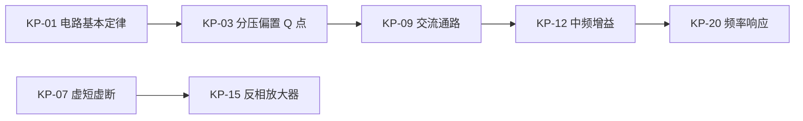

# 知识点脉络（突击）

> 演示档案。规则见 [references/modes/cram.md](../../../ai-study/references/modes/cram.md) §4.2

## 1. 依赖图

## 2. 分组

### A. 前置（不会就全崩）

| 编号 | 知识点 | 依赖 | 你的状态 |
|---|---|---|---|
| KP-01 | 电路基本定律（KVL/KCL、戴维南） | 无 | 🟢 |
| KP-03 | 分压偏置 Q 点 | KP-01 | 🔴 |

### B. 核心（占分最多）

| 编号 | 知识点 | 依赖 | 你的状态 |
|---|---|---|---|
| KP-07 | 运放虚短虚断 | 无 | 🔴 |
| KP-09 | 交流通路画法 | KP-03 | 🔴 |
| KP-12 | 中频增益 | KP-09 | 🟡 |

### C. 拔高（有时间再说）

| 编号 | 知识点 | 依赖 | 你的状态 |
|---|---|---|---|
| KP-20 | 频率响应 | KP-12 | 🟢 |

## 3. 薄弱点（从 05-错题.md 统计）

| 编号 | 知识点 | 错题数 | 状态 |
|---|---|---|---|
| KP-03 | 分压偏置 Q 点 | 1 | 🔴 |
| KP-07 | 虚短虚断 | 1 | 🔴 |
| KP-09 | 交流通路 | 1 | 🔴 |

状态：🔴 反复错 / 🟡 错过一次 / 🟢 没错过
